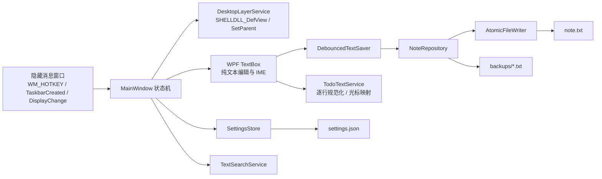

# 架构说明

## 设计目标

架构围绕四个约束展开：空闲时接近零工作量、任何时刻只有一份人类可读主文本、Explorer 桌面层和编辑前台之间可逆切换、核心行为不依赖 WPF 以便测试。

## 组件关系

`DeskNote.Core` 不引用 WPF 或 Win32。搜索、快捷键语法、设置归一化、保存队列和文件持久化可以在普通测试进程中执行。`DeskNote.App` 只负责界面和 Windows 集成。

## 窗口状态机

### 桌面状态

1. 读取窗口屏幕坐标；
2. 枚举 Explorer 顶层窗口，找到当前真正可见且全屏的 `SHELLDLL_DefView`；
3. 把笔记 HWND 改为 `WS_CHILD`，增加 `WS_EX_NOACTIVATE | WS_EX_TOOLWINDOW`；保留鼠标命中以便点击进入编辑；
4. 通过 `SetParent` 直接嵌入 `SHELLDLL_DefView`，验证父句柄和可见性，再换算客户区坐标；
5. 编辑器设为只读且不接收命中，普通应用自然遮挡它。

不能按类名任取 `WorkerW`：Windows 11 上可能同时存在多个隐藏的 `136×39` Helper WorkerW，甚至没有传统教程所假设的全屏壁纸 WorkerW。`SHELLDLL_DefView` 是当前会话中实际可见的桌面图标宿主；笔记作为其直接子窗口并置于 `SysListView32` 图标列表之前，因此位于壁纸之上。其根顶层窗口 `Progman` 仍位于普通应用之后，所以普通窗口自然遮挡笔记，而 Shell“显示桌面”不会最小化这个子窗口。

显示设置、主题/DWM、休眠恢复和 Explorer 重启会触发防抖后的桌面层检查。另有一个 30 秒低频健康检查，仅验证父层、可见宿主、DWM cloak 状态和图标列表 Z 序；健康时不写文件、不调整窗口。只有发现异常才重新定位 `SHELLDLL_DefView` 并嵌入，连续三次失败则退回可见编辑状态，避免笔记静默消失。

### 编辑状态

1. 保存当前屏幕矩形并解除父子关系；
2. 恢复顶层窗口样式和原屏幕坐标；
3. 激活窗口，把焦点交给 `TextBox`；
4. 每次进入都把光标和滚动位置放到文档末尾；
5. 显示拖动、设置、退出和状态区域。

全局快捷键绑定在一个始终隐藏的顶层消息 HWND，而不是可见笔记 HWND。原因是可见窗口在桌面状态是 Explorer 子窗口，不能可靠接收只广播给顶层窗口的 Shell 消息。

第二次启动不会创建另一份编辑器或只弹提示框，而是广播一个进程专用的注册消息；已有实例的隐藏消息 HWND 收到后解除桌面父层、激活编辑窗口并定位末尾。这为快捷键之外提供了明确的可见性恢复入口。

## 保存一致性

一次保存的顺序如下：

1. `DebouncedTextSaver` 接收 UI 线程创建的不可变字符串快照；
2. `NoteRepository` 用 `SemaphoreSlim` 串行化保存，跳过未变化内容；
3. 如果主文件存在，先复制为带毫秒时间戳的备份；
4. 在同目录写入唯一临时文件，使用 UTF-8 无 BOM 并刷新流；
5. `File.Replace` 原子替换主文件；不支持时退回同卷覆盖移动；
6. 仅保留配置数量的最新备份。

临时文件与目标文件位于同目录，避免跨卷移动破坏原子替换语义。取消只用于延迟或写入前阶段；退出路径会等待当前写入完成并再保存最新快照。

## TODO 文本、滚动与搜索

WPF `TextBox` 提供纯文本、IME、选择、剪贴板、撤销/重做和字符索引 API。`TodoTextService` 保证每个非空行以 `☐ ` 或 `☑ ` 开头，空行不带标记；它输出最小文本编辑集合并映射光标/选择位置，避免每次输入都整体替换文本。编辑状态下只在行首标记的命中区域拦截鼠标点击并切换一个字符。输入期间通过 `TextCompositionManager` 识别 IME 组合阶段，等中文候选提交后再规范化该行，避免插入 TODO 前缀打断拼音组合。

旧的普通文本及 Markdown 任务前缀会在加载时迁移，迁移仍经过 `NoteRepository`，因此旧文件先进入备份。磁盘主文件继续是 UTF-8 无 BOM 的人类可读文本，没有额外数据库或隐藏状态。

进入编辑状态时，窗口在获得焦点后将光标移到文本末尾并调用 `ScrollToEnd`；进入/重新进入桌面层时，在 WPF 完成布局后再次调度 `ScrollToEnd`。这样快捷键切换、首次启动、退出编辑和 Explorer 重嵌入使用同一末尾定位语义。

行距通过继承的 `TextBlock.LineHeight` / `LineStackingStrategy` 设置。搜索逻辑使用 `Ordinal` 或 `OrdinalIgnoreCase`，下一个从当前选择末尾开始，上一个从当前选择前方开始，到边界后循环。

第一版保留完整字符串是有意决策：需求明确不做数 GB 专业编辑器。只有真实数据证明 UI 性能不足后，才考虑 Piece Tree/Rope 或分块存储。

## 故障策略

- 快捷键注册冲突：保留/恢复旧快捷键；启动时冲突则停留在可见编辑状态；
- WorkerW 查找或嵌入失败：不启用置顶替代，停留在可见编辑状态并记录错误；
- 设置 JSON 损坏：复制原文件为 `settings.invalid-*.json`，使用安全默认值；
- 自动保存失败：保持编辑内容在内存，界面显示错误，日志记录异常；
- 退出前保存失败：取消退出，避免静默丢失。

## 外部依赖与维护

运行时代码只使用 .NET 10、WPF 和 Windows `user32.dll`。测试项目唯一的 NuGet 依赖是 MSTest。所有项目开启 Nullable、确定性构建和“警告即错误”。
